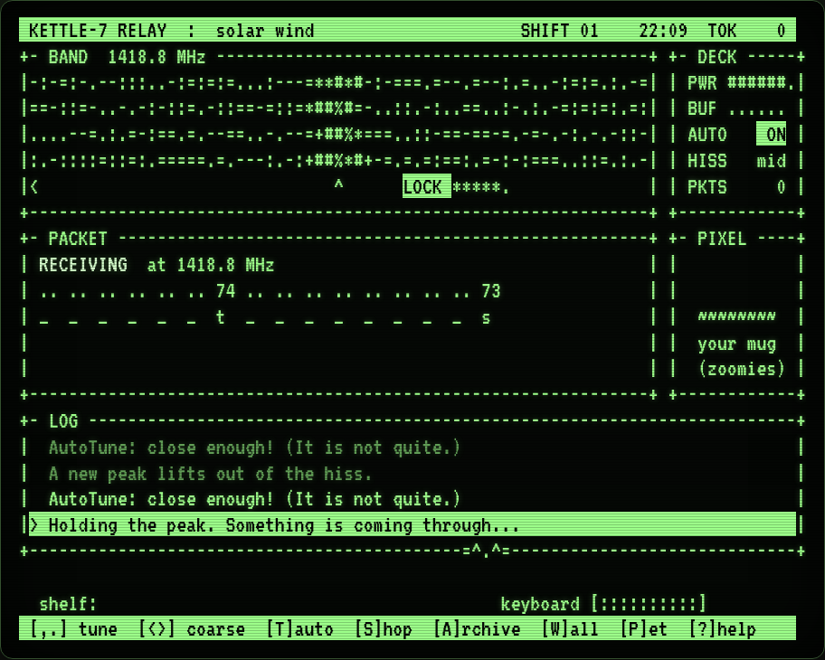

# Signal Seeker

A cozy, endless night shift at a small relay station, written in **Z80 assembly** for
**CP/M 2.2**. 4 MHz, 80x24, VT100 / VT52 / ADM-3A. No colour, no hurry, no game over.



You are the night operator of **Relay Station Kettle-7**, at the edge of the **Lantern
Nebula**. Signals drift across the band; you catch them, clean them and pass them on.
Eight callers tell their stories a letter at a time, signals from nobody carry the
fragments of a lost civilization, and **PIXEL**, the station cat, does as she pleases.
The station keeps running when you step away.

- A live spectrogram you tune by hand (or let AutoTune have a cheerful go at).
- Packets with noisy bits to flip clean, and a relay-routing puzzle for the callers' letters.
- Eight recurring callers, postcards, a stamp book, an Archive, and one last lantern.
- A shop for the station, a weather system, a night that ends at dawn, a save file.
- Plain ASCII only, so it works on any terminal that speaks one of the three dialects.

## Playing

You need a CP/M 2.2 machine (or an emulator) with a VT100, VT52 or ADM-3A console. Take
`SIGSEEK.COM` and `SIGSEEK.DAT` from the [releases](https://github.com/cstroie/signal-seeker/releases)
and copy them onto a disk (**both**, side by side), then run:

```
A>SIGSEEK          asks for your terminal the first time
A>SIGSEEK /100     VT100        /52   VT52        /ADM   ADM-3A
```

The terminal is remembered in `SIGSEEK.SAV`, which holds the whole station. Delete it to
start afresh. About 45K of disk, and a 64K machine.

### Keys

The bottom line of the screen always shows the keys that work just then.

| Key | |
|---|---|
| `,` `.` or left, right | tune by 0.1 MHz |
| `<` `>` or up, down | tune by 1 MHz |
| `T` | AutoTune (cheerful; not very useful) |
| `C` | clean the packet in the buffer |
| `1`-`8` | flip a bit of the selected byte (wrong flips cost nothing) |
| `SPACE` / `R` | turn a relay in the routing puzzle; arrows move |
| `S` | the shop |
| `A` | the Archive |
| `W` | the postcard wall |
| `K` | the stamp book |
| `F` | fix the power, when it sags |
| `L` | print the Archive or the wall (on a printer) |
| `P` | pet PIXEL, or call her |
| `?` | how the night works |
| `Q` | quit (the station is saved) |

### How a shift goes

Hold the dial on a signal until **LOCK** lights up and the packet comes in letter by letter.
Press `C` to clean it (flip each noisy byte's one wrong bit), and it is delivered for tokens.
A packet from a caller has to reach them: rotate the relays until the line runs from `ANT`
to their name. Their letter shows, and each one moves their story on. Signals from nobody
carry fragments of the old Lantern beacons: they go in the Archive. Spend tokens in the
shop. A shift runs from 22:00 to 06:00, about 24 minutes, and the night is tallied at dawn.

The full player's text is in [`docs/PLAYING.txt`](docs/PLAYING.txt). I will not spoil the rest.

## Building

You need [pasmo](https://pasmo.speccy.org/) (`apt install pasmo`) and Node.js.

```
sh build.sh                  SIGSEEK.COM (pasmo) and SIGSEEK.DAT (mkdat.js)
PASMO=/path/to/pasmo sh build.sh
DEST=/some/disk/dir sh build.sh      also copy both files there
node --test test/*.test.js   SIGSEEK.DAT is current with sigseek.txt (build first)
```

The game's words (messages, letters, Archive fragments, postcards) are in `sigseek.txt`;
`mkdat.js` packs them into `SIGSEEK.DAT` and refuses a line too long for the screen.
Edit the text, run `node mkdat.js`, and the game speaks it, no assembler needed.
The version is in [VERSION](VERSION), the history in [CHANGELOG.md](CHANGELOG.md).

## Source

| File | Role |
|------|------|
| `sigseek.asm` | main: start, loop, keys, terminal driver, the band, signals, lock and capture, receiving, AutoTune, the screen, the log |
| `cat.asm` | PIXEL: moods, poses, walks, spots, petting, gifts, the away diary |
| `clean.asm`, `route.asm` | the bit-flip puzzle and delivery; the relay routing puzzle |
| `shop.asm`, `story.asm`, `weather.asm`, `cards.asm` | shop and save file; the callers and the Archive; weather and the last lantern; postcards |
| `echo.asm`, `reply.asm`, `upkeep.asm`, `stamps.asm`, `print.asm`, `title.asm` | echoes, replies, the power register, the stamp book, the printer, title and dawn |
| `sigseek.txt`, `mkdat.js` | the content, and its packer |

[`DESIGN.md`](DESIGN.md) is the design document: terminals, the screen, the main loop, every
mechanic, the `SIGSEEK.DAT` and `SIGSEEK.SAV` formats, and how it was tested.

## Testing

The game was tested headless on [DigitalRerun](https://github.com/cstroie/digital-rerun)'s own
Z80 core and CP/M 2.2, with scripted operators that read the game's memory (through pasmo's
symbol table) and press keys. That harness lives in DigitalRerun, which has this repository
as a submodule at `apps/sigseek` and ships the released files on its shelf.

## Licence

MIT, see [LICENSE](LICENSE). Copyright (c) 2026 Costin Stroie. Signal Seeker is a separate project
from DigitalRerun: DigitalRerun only ships the built files, under this same licence, and its own
licence terms do not apply to them.
